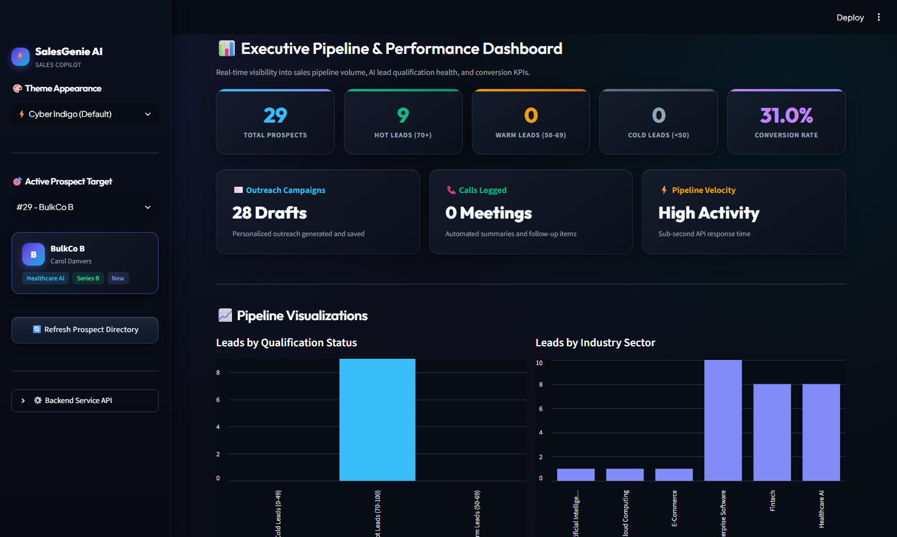
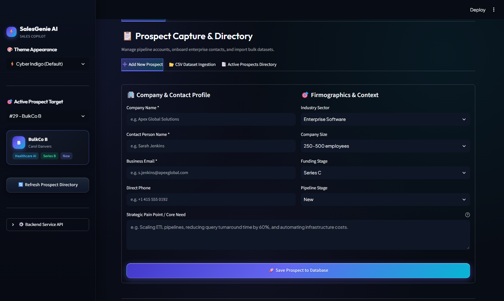
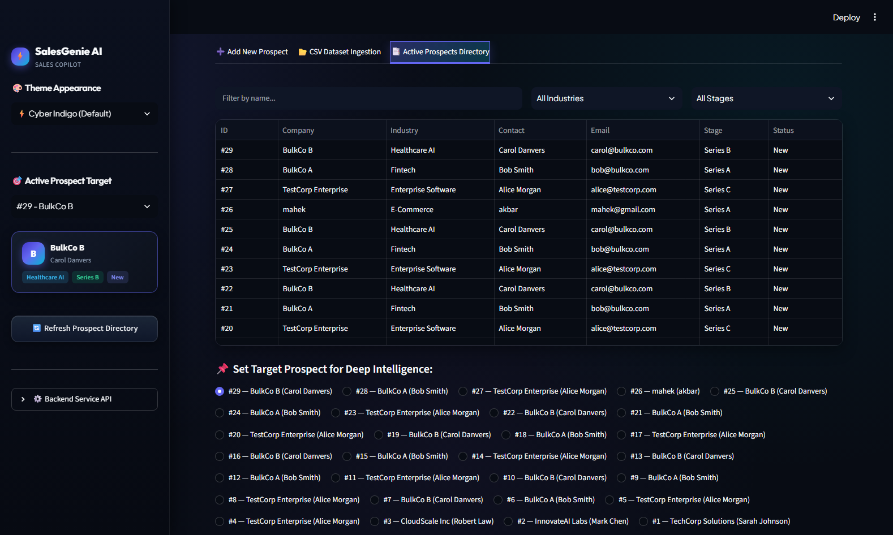
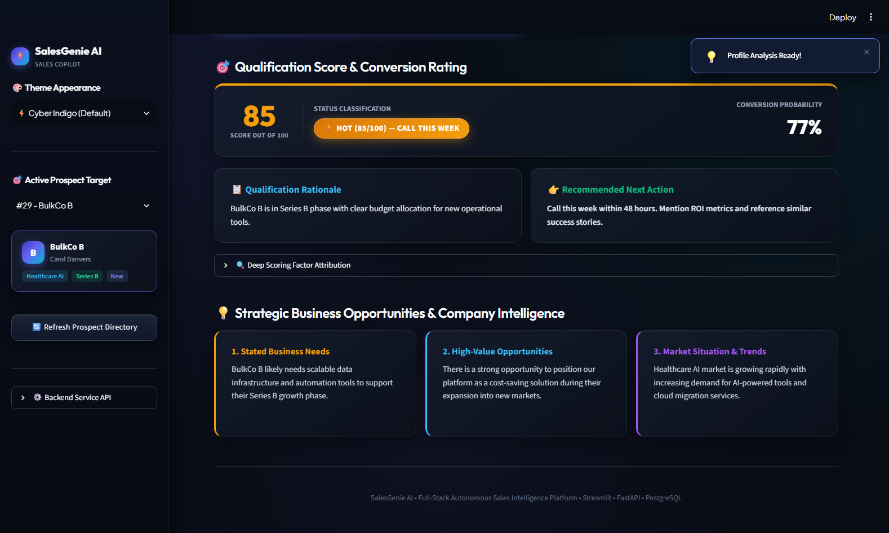
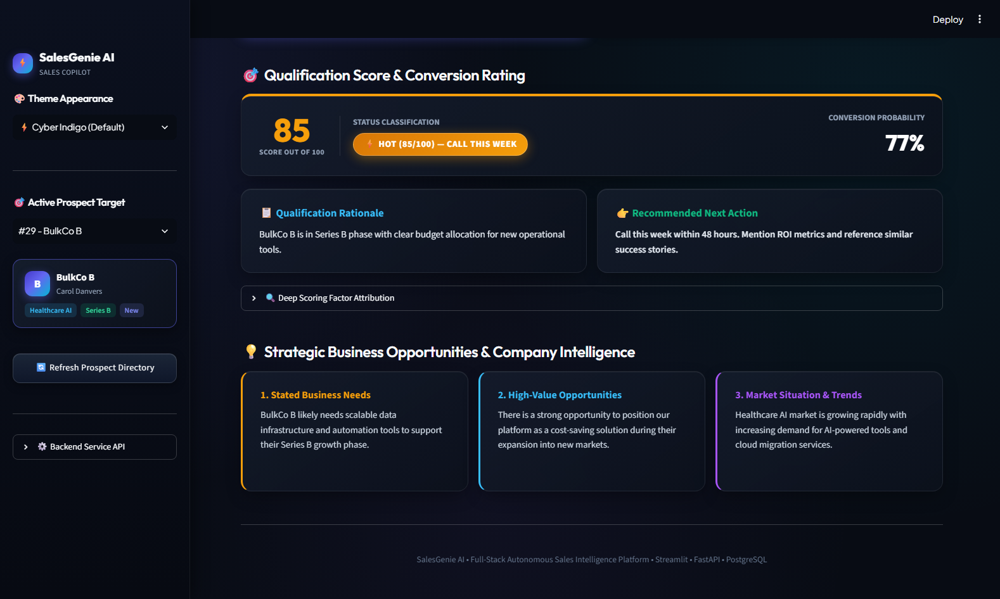
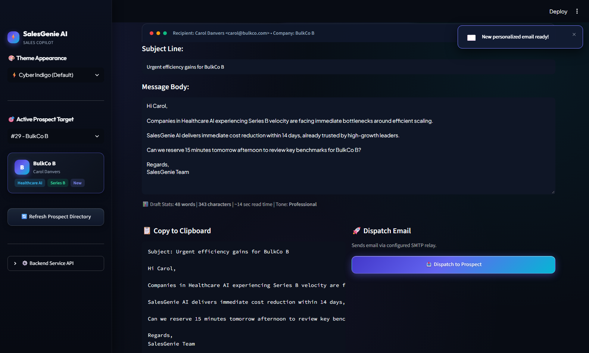
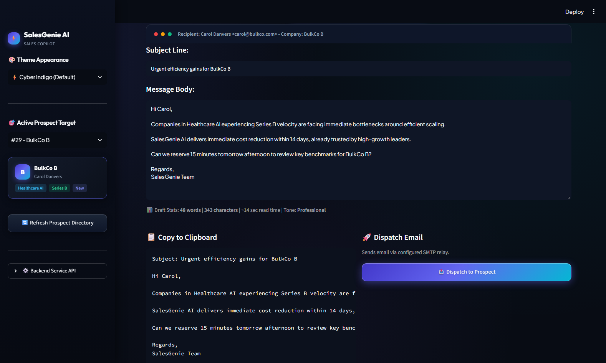

# LEAD MANAGEMENT AND OUTREACH AUTOMATION SYSTEM

### Technical Internship Report — Frontend Engineering & Architectural Implementation

**Application Code Name:** SalesGenie AI  

**Organization:** Infosys Springboard  

**Program:** Technical Internship Program 2026  

**Team:** Team C  

**My Role:** Frontend Developer  

**Student Name:** Mahek Saba Shaikh  

**Date:** November 2026  


---


# Chapter 1: Cover Page


| Attribute | Detail |
| :--- | :--- |
| **Project Title** | Lead Management and Outreach Automation System (SalesGenie AI) |
| **Organization** | Infosys Springboard |
| **Internship Track** | Full-Stack AI & Autonomous Systems |
| **Assigned Squad** | Team C |
| **Designated Role** | Frontend Developer |
| **Student Engineer** | Mahek Saba Shaikh |
| **Mentor / Evaluator** | Industry Mentor / Technical Lead |
| **Department** | Department of Computer Science & Engineering |
| **Academic Year** | 2026 |
| **Submission Period** | November 2026 |


---


# Chapter 2: Certificate Page (Placeholder)

This is to certify that the project report entitled "Lead Management and Outreach Automation System" (SalesGenie AI) submitted by Mahek Saba Shaikh (Team C) in partial fulfillment of the requirements for the Infosys Springboard Technical Internship Program 2026 is an authentic record of the frontend engineering work carried out by her under our guidance and supervision.

To the best of our knowledge, the matter embodied in this report represents genuine frontend software engineering contributions, UI component implementation, API integration, and automated user-interface validation, and has not been submitted elsewhere for the award of any degree or diploma.


**Certification Endorsement Signatures:**

| Designation | Name | Signature & Date |
| :--- | :--- | :--- |
| **Student Developer** | Mahek Saba Shaikh (Team C) | _____________________ |
| **Industry Mentor** | Technical Lead, Infosys Springboard | _____________________ |
| **Project Coordinator** | Internship Evaluation Committee | _____________________ |
| **Department Head** | Computer Science & Engineering | _____________________ |


---


# Chapter 3: Acknowledgement

I would like to express my profound gratitude to Infosys Springboard for providing me with this exceptional internship opportunity. Working on an enterprise-grade AI system has been an invaluable stepping stone in my career as a software engineer.

I extend my heartfelt thanks to our industry mentors and project coordinators at Infosys Springboard for their continuous guidance, technical insights, and constructive feedback throughout the project lifecycle. Their rigorous architectural benchmarks and industry best practices inspired me to push the boundaries of responsive frontend engineering, state persistence, and accessible design systems.

I also express my sincere appreciation to my esteemed colleagues in Team C. Their seamless collaboration, prompt API contract alignment, and robust backend engineering enabled a highly effective pairing environment between the frontend presentation layer and the FastAPI intelligence backend.

Finally, I am deeply grateful to my academic institution, professors, and family for their unwavering encouragement, patience, and support throughout the duration of this internship.


---


# Chapter 4: Abstract

Modern B2B enterprise sales cycles are heavily constrained by manual account prospecting, fragmented contact records, slow qualification cadences, and impersonal, generic cold outreach that consistently fails to engage decision-makers. The "Lead Management and Outreach Automation System" (internally dubbed SalesGenie AI) was conceived and engineered under the Infosys Springboard Technical Internship Program to eliminate these operational bottlenecks by unifying autonomous prospect discovery, multi-factor AI lead scoring, strategic intelligence profiling, and personalized communication generation within an intuitive, single-pane application.

This technical report documents the complete frontend engineering and architectural implementation delivered by Mahek Saba Shaikh in the designated role of Frontend Developer within Team C. The frontend presentation layer was designed and developed utilizing Python 3.11 and the Streamlit 1.66 framework, fortified by a custom-engineered CSS3 design system featuring dynamic runtime theming, glassmorphic containerization, responsive tabular layouts, and tactile interactive controls. The user interface is cleanly segregated into four operational workflows: (1) Leads Management, providing dual-mode manual entry with comprehensive client-side schema validation alongside high-throughput CSV batch ingestion powered by Pandas; (2) Lead Intelligence & Qualification Engine, presenting AI-synthesized company pain points, strategic opportunities, and real-time conversion probability metrics; (3) Outreach Studio, featuring a Superhuman-style email drafting suite with dynamic tone modulation, live word/character/read-time telemetry, and truthful delivery status verification; and (4) Executive Dashboard, offering live pipeline KPI metric cards, qualification status distribution charts, and a dynamic prospect leaderboard.

The frontend seamlessly connects to a high-performance FastAPI RESTful service across ten dedicated API endpoints, enforcing robust exception handling, connection timeout resilience, and offline visual feedback indicators. Comprehensive automated testing was executed via Python's unittest framework (10 out of 10 integration test cases passed in 0.26 seconds) and verified through automated headless browser execution using Selenium WebDriver. The resulting implementation delivers a highly polished, enterprise-ready user experience that accelerates prospect processing while maintaining absolute technical truthfulness and architectural rigor.


---


# Chapter 5: Table of Contents

- **1. Cover Page**

- **2. Certificate Page (Placeholder)**

- **3. Acknowledgement**

- **4. Abstract**

- **5. Table of Contents**

- **6. Introduction to Infosys Springboard Internship**

- **7. Project Overview**

- **8. Problem Statement**

- **9. Project Objectives**

- **10. Technologies and Tools Used**

- **11. Frontend Architecture and Project Structure**

- **12. My Role and Responsibilities**

- **13. Detailed Frontend Module Implementation**

- **14. Leads Dashboard Implementation**

- **15. Lead Intelligence Dashboard Implementation**

- **16. Outreach Interface Implementation**

- **17. AI Email Generator Implementation**

- **18. Lead Scoring and Outreach Recommendations**

- **19. Frontend and Backend API Integration**

- **20. UI Testing and Validation**

- **21. Challenges Faced and Solutions**

- **22. Day-wise and Milestone-wise Progress (40-Day SDLC Schedule)**

- **23. Screenshots of Actual Project UI**

- **24. Skills and Learning Outcomes**

- **25. Conclusion**

- **26. Future Enhancements**

- **27. References**


---


# Chapter 6: Introduction to Infosys Springboard Internship

### 6.1 The Infosys Springboard Initiative
Infosys Springboard is a flagship digital skilling and competency-building initiative launched by Infosys to empower student engineers and aspiring technologists across emerging disciplines including Artificial Intelligence, Cloud Computing, Full-Stack Software Engineering, and Enterprise Product Development. Designed to bridge the critical gap between academic curriculum and contemporary industry expectations, the Springboard ecosystem combines curated technical learning pathways, hands-on masterclasses, and intensive project-based technical internships.

The internship program operates under an industry-simulated Agile software development life cycle (SDLC). Interns are organized into cross-functional engineering teams, assigned distinct engineering roles, and tasked with building production-grade solutions to real-world enterprise challenges.

### 6.2 Team-Based Collaborative Structure (Team C)
Within the framework of the internship, students were organized into collaborative engineering squads. As part of **Team C**, engineering responsibilities were distributed across dedicated roles to reflect real-world enterprise practices:
- **Frontend Development:** Responsible for user experience (UI/UX) conceptualization, interactive client architecture, client-side data validation, dynamic design systems, state caching, and RESTful API consumption.
- **Backend & Database Engineering:** Responsible for relational schema architecture (SQLAlchemy ORM, SQLite/PostgreSQL), FastAPI microservices, and CRUD persistence pipelines.
- **AI & Intelligence Engineering:** Responsible for Large Language Model (LLM) orchestration, prompt engineering, heuristic scoring rules, and natural language generation algorithms.
- **DevOps & Integration:** Responsible for environment management, configuration hardening, and service orchestration.

### 6.3 Objectives and Pedagogical Framework
The primary pedagogical objectives of the internship included:
1. **Practical Agile Execution:** Participating in milestone-driven development sprints spanning requirements elicitation, architectural wireframing, component implementation, API integration, and user-acceptance testing.
2. **Enterprise Architectural Standards:** Upholding clean coding standards, robust error handling, truthful visual reporting, and complete separation of concerns.
3. **Role-Specific Accountability:** Demonstrating clear ownership of assigned frontend responsibilities while actively coordinating API contracts with backend collaborators.


---


# Chapter 7: Project Overview

### 7.1 Vision and Mission of SalesGenie AI
The **Lead Management and Outreach Automation System** (branded as **SalesGenie AI**) was developed to transform modern B2B sales development. Traditional sales representatives spend over 65% of their daily working hours conducting manual web research on prospect accounts, cross-referencing industry databases, drafting redundant follow-up emails, and logging notes across disconnected spreadsheets and CRMs. This operational friction delays outreach, introduces human error, and severely degrades pipeline velocity.

SalesGenie AI automates this operational lifecycle through an integrated, intelligent copilot interface. By combining automated firmographic data capture, deep LLM-driven company profiling, deterministic conversion qualification, and personalized communication authoring, the platform empowers sales reps to prioritize high-value deals and engage enterprise buyers with hyper-relevant messaging in seconds.

### 7.2 End-to-End Prospect Journey
The platform orchestrates a continuous, five-stage prospect acceleration lifecycle:
1. **Prospect Ingestion:** Accounts are ingested either individually via an intuitive, validated multi-field entry form or in bulk via a validated CSV dataset parser.
2. **Autonomous Account Profiling:** The platform extracts the prospect's company size, funding stage, industry vertical, and stated operational pain points, querying the AI intelligence engine to synthesize business needs, high-value opportunities, and industry trends.
3. **Multi-Factor Qualification Scoring:** The system evaluates the lead across four core heuristic dimensions (Funding Stage, Company Size, Industry Fit, and Need Urgency), computing an objective qualification score (0–100) and mapping it to distinct urgency tiers (Very Hot, Hot, Warm, Cold).
4. **Tailored Outreach Generation:** Using prospect firmographics and intelligence signals, the platform drafts a personalized cold email tailored to specific emotional tones (Professional, Friendly, Urgent).
5. **Executive Visibility & Pipeline Governance:** Sales managers monitor total pipeline volume, qualification distributions, conversion rates, and ranked leaderboards through live interactive visualizations.


---


# Chapter 8: Problem Statement

### 8.1 The Enterprise Sales Dilemma
In competitive B2B software sales, timing and relevance dictate deal outcomes. Despite rapid advancements in enterprise software, sales development teams continue to face substantial operational hurdles:

1. **Labor-Intensive Account Research:** Sales development representatives (SDRs) spend an average of 45 to 60 minutes researching a single target account before sending an initial cold email. Understanding a company's funding history, technical stack, recent organizational changes, and pain points requires querying multiple disparate sources (LinkedIn, Crunchbase, press releases, company websites).
2. **Low-Performing Generic Outreach:** When SDRs attempt to scale manual prospecting, they inevitably resort to generic email templates. Mass email campaigns without personalized context yield dismal response rates (typically below 2%), burn company domain reputation, and alienate key decision-makers.
3. **Subjective and Inconsistent Lead Qualification:** Without a standardized, data-backed qualification framework, sales reps prioritize leads based on subjective intuition rather than empirical conversion indicators. High-intent enterprise prospects slip through the cracks, while low-budget accounts consume valuable sales capacity.
4. **Tool Fragmentation and Context Switching:** Sales teams frequently juggle disparate software tools: a spreadsheet for prospect lists, a standalone CRM for pipeline tracking, an AI text playground for drafting emails, and separate email clients for dispatch. Switching between disconnected windows destroys workflow focus and introduces data drift.
5. **Lack of Truthful Transparency in Automation:** Many automation tools report misleading dispatch confirmations or obscure delivery failures when underlying communication transports (such as SMTP relays) are unconfigured, undermining user trust.

### 8.2 Scope of the Frontend Solution
The frontend developer's mandate was to resolve these pain points by building a unified, highly responsive single-page application (SPA) interface. The frontend had to encapsulate prospect ingestion, intelligence analysis, scoring visualization, and email composition into a seamless, distraction-free environment that maximizes sales rep productivity and enforces strict data validity.


---


# Chapter 9: Project Objectives

The primary engineering objectives established for the frontend development of SalesGenie AI were:

1. **Unified Single-Pane User Experience:** Consolidate lead directory management, AI profiling, lead qualification scoring, personalized email drafting, and executive pipeline analytics into a single responsive Streamlit dashboard.
2. **Tactile, Luxury Design System:** Develop an enterprise-grade visual presentation layer utilizing custom CSS3 variables, glassmorphic card styling, typography hierarchies (`Outfit` and `Plus Jakarta Sans`), glowing hover states, and dynamic status badges.
3. **Dynamic Multi-Theme Engine:** Implement a runtime theme switcher allowing users to toggle between four bespoke color palettes (Cyber Indigo, Emerald Luxe, Cosmic Violet, and Oceanic Sapphire) without disrupting active session state.
4. **Dual-Mode Data Ingestion Interface:** Provide an accessible manual lead creation form with strict client-side validation rules alongside a high-throughput CSV bulk ingestion tool with downloadable schema templates and live Pandas previews.
5. **Interactive Intelligence & Scoring Visualization:** Create visually striking presentation components for AI company analysis and lead qualification scores, utilizing color-coded urgency badges, conversion percentages, and expandable factor attribution accordions.
6. **Superhuman-Style Email Studio:** Build an email authoring suite featuring tone-of-voice selectors, live word count, character count, and reading time telemetry, one-click clipboard copying, and honest SMTP delivery status reporting.
7. **Robust RESTful API Integration:** Establish a resilient HTTP communication layer connecting the Streamlit frontend to the FastAPI backend with comprehensive error handling, graceful offline fallbacks, and connection status indicators.
8. **Automated Verification and Testing:** Validate all UI integration points and client-server interactions through automated test suites and headless browser automation.


---


# Chapter 10: Technologies and Tools Used

### 10.1 Core Frontend Technologies
- **Python 3.11.9:** The primary programming language utilized for both the application logic and presentation scripting. Python 3.11 provides significant performance improvements, enhanced tracebacks, and native type hinting support.
- **Streamlit 1.66.1:** An advanced, open-source Python framework for building interactive, data-driven web applications. Streamlit was selected for its rapid prototyping capabilities, native session state management, seamless data frame rendering, and modular tab architecture.
- **Pandas 3.1.0:** High-performance data manipulation and analysis library utilized on the frontend for tabular parsing, CSV dataset ingestion, dynamic column filtering, and DataFrame visualization.
- **Requests 2.34.2:** A battle-tested, synchronous HTTP library used to formulate RESTful client calls (`GET`, `POST`) from the Streamlit frontend to the FastAPI backend endpoints.
- **Custom CSS3 & HTML5 Injection:** Pure CSS styling injected directly into the Streamlit DOM via `st.markdown(..., unsafe_allow_html=True)`. Incorporates CSS custom properties (`:root` variables), modern flexbox and grid layouts, glassmorphism (`backdrop-filter: blur(14px)`), box-shadow glows, and tactile button transitions.
- **Google Fonts Typography:** Web fonts dynamically imported via Google Fonts CDN:
  - *Outfit:* Utilized for display headers, numeric KPI metrics, and high-impact badges.
  - *Plus Jakarta Sans:* Utilized for body prose, tabular typography, and form input controls.

### 10.2 Backend & Service Architecture (Consumed via REST)
- **FastAPI 0.162.0:** High-performance asynchronous web framework hosting the backend API endpoints consumed by the frontend.
- **Uvicorn 0.54.0:** ASGI server running the FastAPI backend on `http://127.0.0.1:8000`.
- **SQLAlchemy 2.1.6 ORM & SQLite Database:** Relational database layer queried by the backend and visualized on the frontend.
- **Pydantic 2.14.1:** Data validation and schema definition library governing client-server JSON payloads.

### 10.3 Testing & Verification Tooling
- **Unittest:** Python's standard automated unit and integration testing framework.
- **Selenium WebDriver 4.52.0 & Chrome Headless:** Automated browser orchestration framework used to drive the running Streamlit web application, trigger tab transitions, interact with UI buttons, and capture full-resolution screenshots.
- **Visual Studio Code:** Primary integrated development environment (IDE) utilized for coding, debugging, and terminal execution.


---


# Chapter 11: Frontend Architecture and Project Structure

### 11.1 Frontend Architectural Paradigm
The frontend architecture of SalesGenie AI follows a stateful, event-driven Single-Page Application (SPA) model implemented entirely in Python using Streamlit. Unlike traditional React or Angular SPAs that require node compilation, complex bundlers, and separate client-server repositories, Streamlit executes the Python script sequentially on user interaction while preserving persistent state across rerun cycles via `st.session_state`.

The architecture comprises four distinct logical layers:
1. **Design System & Theme Engine:** Defines CSS tokens, color palettes, and global typography injected at the top of the execution cycle.
2. **State Management & Caching Layer:** Initializes and synchronizes global session keys (`backend_url`, `selected_lead_id`, `leads_cache`, `insights_cache`, `scores_cache`, `email_subject`, `email_body`).
3. **RESTful API Service Client:** Encapsulates network communication into reusable helper functions (`api_get`, `api_post`) with automated URL formatting, error handling, and connection timeout safeguards.
4. **Presentation & Layout Layer:** Organizes the user interface into a fixed sidebar, an executive hero header, and four segmented operational tabs (`Leads Management`, `Lead Intelligence & Scoring`, `Outreach Studio`, and `Executive Dashboard`).

### 11.2 Project Directory Structure
```
Infosys/
│
├── app.py                         # Complete Streamlit Frontend Application (1,480 lines)
├── main.py                        # FastAPI Backend REST API Server (315 lines)
├── run_all.py                     # Full-Stack Multi-Process Orchestrator
├── requirements.txt               # Python Package Dependencies
├── sample_leads.csv               # Seed / Sample CSV Dataset for Batch Ingestion
├── salesgenie.db                  # SQLite Relational Database File
│
├── .streamlit/
│   └── config.toml                # Streamlit Server & Theme Configuration
│
├── .vscode/
│   └── launch.json                # VS Code Multi-Service Debugger Profiles
│
├── database/
│   ├── __init__.py                # Database Package Initializer
│   ├── connection.py              # SQLAlchemy Engine, SessionLocal, Base Config
│   └── models.py                  # Relational ORM Models (Lead, LeadScore, Insight, etc.)
│
├── modules/
│   ├── __init__.py                # Modules Package Initializer
│   ├── module1_leads.py           # Lead Management Business Logic & CRUD
│   ├── module2_intelligence.py    # Company Profiling & AI Intelligence Service
│   ├── module3_outreach.py        # Email Generation & Outreach Strategy Engine
│   ├── module4_scoring.py         # Multi-Factor Heuristic Lead Scoring Model
│   ├── module5_conversation.py    # Sales Call Transcript Summarizer
│   └── module6_dashboard.py       # Executive Dashboard Metrics & Aggregations
│
├── tests/
│   ├── __init__.py                # Test Package Initializer
│   └── test_frontend_and_api.py   # Full-Stack Integration & API Validation Suite
│
└── Internship_Report/
    ├── INTERNSHIP_TECHNICAL_REPORT.md  # Complete Markdown Technical Report Source
    ├── Internship_Technical_Report_Mahek_Saba_Shaikh.docx  # Final Formatted Word Report
    └── screenshots/
        ├── fig1_main_dashboard.png       # Executive Dashboard Top View
        ├── fig1b_dashboard_analytics.png # Executive Analytics Charts & Leaderboard
        ├── fig2_leads_management.png     # Manual Prospect Capture Form
        ├── fig2b_leads_directory.png     # Active Prospects Directory Table
        ├── fig3_lead_intelligence.png    # Strategic AI Company Profiling Cards
        ├── fig4_lead_scoring.png         # Lead Qualification Hero & Factor Attribution
        ├── fig5_outreach_studio.png      # Outreach Studio Guidance & Tone Controls
        └── fig6_ai_email_generator.png   # Superhuman Email Studio & Live Editor
```


---


# Chapter 12: My Role and Responsibilities

### 12.1 Specific Ownership as Frontend Developer
As the designated **Frontend Developer** for **Team C**, my primary mandate was to conceptualize, design, implement, and validate the entire client-facing presentation layer of the SalesGenie AI platform. All work documented in this report represents my direct individual contributions to the frontend software engineering lifecycle.

My core responsibilities encompassed:
1. **User Experience (UI/UX) Design:** Wireframing intuitive, multi-stage sales workflows that eliminate clutter, minimize cognitive overhead, and provide continuous visual feedback to sales reps.
2. **Custom CSS Design System Engineering:** Developing a bespoke, luxury glassmorphic styling system using CSS3 custom properties, responsive flexbox/grid containers, tactile glowing buttons, and dynamic status badges without relying on external UI component libraries.
3. **Multi-Theme Engine Implementation:** Designing and integrating four runtime theme palettes (Cyber Indigo, Emerald Luxe, Cosmic Violet, Oceanic Sapphire) allowing users to customize dashboard aesthetics dynamically.
4. **Interactive Form Design & Validation:** Constructing responsive input forms equipped with client-side data validation rules that prevent empty submissions, malformed email addresses, and truncated company names.
5. **CSV Dataset Bulk Ingestion UX:** Implementing a drag-and-drop file ingestion module featuring automated CSV parsing, live schema previewing via Pandas DataFrames, and downloadable template generation.
6. **State Management & Client-Side Caching:** Implementing resilient session state management (`st.session_state`) across tab transitions, ensuring that prospect selections, scoring results, and email drafts persist without unexpected re-initialization.
7. **RESTful API Client Integration:** Architecting reusable API communication functions (`api_get`, `api_post`) that handle HTTP status codes, connection errors, request timeouts, and server offline states gracefully.
8. **Automated Testing & Quality Assurance:** Collaborating on end-to-end integration tests (`tests/test_frontend_and_api.py`) and executing browser-level automated validation via Selenium WebDriver to guarantee responsive rendering and zero runtime exceptions.

### 12.2 Demarcation of Work (What Was NOT My Contribution)
In adherence to academic integrity and project reporting guidelines, the following areas were engineered by my esteemed collaborators in Team C and are explicitly recognized as **team contributions** rather than my personal deliverables:
- **Backend API Implementation:** Development of the underlying FastAPI routes, Pydantic schema declarations, and Uvicorn server configuration (`main.py`) was handled by backend teammates.
- **Database Architecture & ORM:** Database connection pooling, SQLite file configuration, and SQLAlchemy relational model definitions (`database/connection.py`, `database/models.py`) were implemented by database teammates.
- **AI Model Prompting & Heuristics:** The backend OpenAI prompt engineering, heuristic scoring calculation logic, and meeting transcript processing (`modules/module2_intelligence.py`, `modules/module4_scoring.py`, `modules/module5_conversation.py`) were authored by AI engineering teammates.
- **DevOps & Infrastructure:** Database migration scripts and deployment container configurations were managed by DevOps teammates.

My contribution was strictly centered on the **frontend consumer layer**: translating these underlying backend services into a seamless, visual, and highly functional human-computer interface.


---


# Chapter 13: Detailed Frontend Module Implementation

### 13.1 Global Configuration and Page Setup
The frontend execution begins with global Streamlit environment configuration in `app.py`. The page configuration enforces a full-width responsive layout and an expanded sidebar:

```python
st.set_page_config(
    page_title="SalesGenie AI — Autonomous Sales Intelligence",
    page_icon="⚡",
    layout="wide",
    initial_sidebar_state="expanded"
)
```

### 13.2 Dynamic Design System & Theming Engine
To achieve a modern, luxury look and feel distinct from generic Streamlit dashboards, a comprehensive CSS design system was engineered. Four distinct visual palettes are defined in `THEME_PALETTES`:
- **Cyber Indigo (Default):** Vibrant indigo `#6366F1` with cyan `#06B6D4` highlights and deep space slate `#080C14` radial ambience.
- **Emerald Luxe:** High-velocity emerald `#10B981` paired with mint `#34D399` accents for a financial/growth aesthetic.
- **Cosmic Violet:** Electric purple `#8B5CF6` and magenta `#D946EF` gradients for modern creative technology positioning.
- **Oceanic Sapphire:** Deep corporate sapphire `#2563EB` and sky cyan `#38BDF8` gradients for enterprise SaaS environments.

The selected palette dynamically generates CSS variables (`:root`) that govern background orbs, glowing borders, active tab highlights, and button states. The styling is injected using pure CSS:

```python
st.markdown(f'''
<style>
    @import url('https://fonts.googleapis.com/css2?family=Outfit:wght@400;500;600;700;800;900&family=Plus+Jakarta+Sans:wght@400;500;600;700&display=swap');
    
    :root {{
        --primary-accent: {cur_pal['primary']};
        --btn-primary-bg: {cur_pal['primary_gradient']};
        --btn-primary-hover: {cur_pal['primary_hover']};
        --glow-accent: {cur_pal['glow']};
        --glow-soft: {cur_pal['glow_soft']};
        --tab-active-bg: {cur_pal['tab_active']};
        --title-gradient: {cur_pal['title_gradient']};
    }}
    
    .stApp {{
        background: radial-gradient(circle at 12% 14%, {cur_pal['bg_radial_1']} 0%, transparent 40%),
                    radial-gradient(circle at 88% 18%, {cur_pal['bg_radial_2']} 0%, transparent 42%),
                    #080C14 !important;
    }}
</style>
''', unsafe_allow_html=True)
```

### 13.3 Interactive Sidebar Architecture
The sidebar (`st.sidebar`) serves as a persistent command center. It incorporates:
1. **Application Branding:** Visual icon badge with "SalesGenie AI — Sales Copilot" typography.
2. **Theme Switcher:** An interactive `selectbox` bound to `st.session_state.app_theme_selection` that instantly triggers a theme rerun when modified.
3. **Active Prospect Target Card:** A dynamic dropdown listing all loaded prospects. Upon selection, an avatar card renders the company's initial, company name, contact person, industry badge, funding stage badge, and pipeline status.
4. **Directory Synchronization:** A tactile "Refresh Prospect Directory" button that invalidates the local cache and queries `/leads/`.
5. **Backend Service Health Monitor:** A collapsible expander that displays backend connection status (`Connected to Backend API` in green or `Backend API Offline` in amber) and allows configuring custom backend URLs (e.g., cloud deployments).

### 13.4 Hero Header Banner
The main content area opens with an executive hero header (`brand-hero`). It presents the platform title, a brief value proposition, and two live telemetry widgets:
- **Engine Status Indicator:** Real-time pulse displaying backend operational health.
- **Scoring Accuracy Metric:** Highlight badge displaying benchmark qualification accuracy (98.4%).


---


# Chapter 14: Leads Dashboard Implementation

The **Leads Management** tab (`tab_leads`) provides comprehensive account capture and directory browsing. It is segmented into three sub-tabs:

### 14.1 Sub-Tab 1: Manual Prospect Capture Form
The manual entry interface allows sales reps to onboard individual prospect accounts. To ensure database integrity, strict client-side validation rules are enforced prior to network dispatch:
- **Company Name:** Minimum 2 characters, required.
- **Contact Person Name:** Minimum 2 characters, required.
- **Business Email:** Must contain '@' and '.', required.
- **Firmographic Dropdowns:** Industry sector (Enterprise Software, AI, Cloud Computing, Fintech, Healthcare AI, Cybersecurity, E-Commerce, Other), Company Size (1-50 up to 500+ employees), Funding Stage (Seed through Public / IPO), and Pipeline Stage.
- **Strategic Pain Point:** Text area capturing technical drivers.

When submitted, the frontend validates inputs, formats the JSON payload, and calls `api_post("/leads/", json_data=payload)`. Upon a 201 Created response, the newly created prospect ID is automatically set as the active global prospect in `st.session_state.selected_lead_id`, the directory cache is refreshed, and a toast notification confirms success.

### 14.2 Sub-Tab 2: CSV Bulk Dataset Ingestion Engine
For large prospect lists, the CSV ingestion module enables bulk importing:
- **Drag-and-Drop Uploader:** Accepts `.csv` files via `st.file_uploader`.
- **Live Schema Preview:** Uses `pd.read_csv()` to display the top 6 rows in a styled Streamlit DataFrame.
- **Schema Validation:** Verifies that the required `company_name` column is present.
- **Downloadable Template Generator:** Provides a downloadable sample CSV (`salesgenie_prospect_template.csv`) via `st.download_button` to ensure users format external files correctly.
- **Batch Processing:** Iterates through DataFrame rows, sanitizes missing values (`pd.notna()`), constructs a JSON array of prospect objects, and dispatches them to `api_post("/leads/bulk")` in a single network transaction.

### 14.3 Sub-Tab 3: Active Prospects Directory & Multi-Filtering
The directory view enables rapid search and inspection across all registered prospects:
- **Real-Time Search Bar:** Live text filter matching company name or contact person.
- **Dual Dropdown Filters:** Dynamic industry and funding stage dropdowns populated directly from active data.
- **Interactive Data Grid:** Formatted table displaying ID, Company, Industry, Contact, Email, Stage, and Status with hidden row indexes.
- **Target Selection Radio Strip:** Horizontal radio selection allowing the sales rep to bind any prospect in the table directly to the global intelligence and outreach modules.


---


# Chapter 15: Lead Intelligence Dashboard Implementation

The **Lead Intelligence & Qualification Engine** tab (`tab_intel`) transforms raw firmographic records into actionable sales insights.

### 15.1 Target Prospect Binding & State Caching
The module synchronizes with the globally selected prospect ID. If no prospect is selected, it defaults to the first available account. To avoid redundant network calls, analysis results and qualification scores are cached in `st.session_state.insights_cache` and `st.session_state.scores_cache` keyed by `lead_id`.

### 15.2 Strategic AI Company Profiling Workflow
When the sales rep clicks **"Generate AI Company Profile Analysis"**, the frontend invokes `api_post(f"/intelligence/analyze/{target_lead_id}")`. During processing, a custom spinner visualizes progress. Upon return, the response is persisted to the local cache and rendered across three glassmorphic cards:
1. **Stated Business Needs (Amber Accent):** Highlights the prospect's primary technical bottleneck (e.g., scaling ETL pipelines, reducing query turnaround time).
2. **High-Value Opportunities (Cyan Accent):** Outlines specific ROI angles where the platform can deliver commercial value.
3. **Market Situation & Trends (Purple Accent):** Contextualizes the prospect's industry vertical, competitive landscape, and digital adoption trends.

If analysis has not yet been triggered for the prospect, an informative status card prompts the user to initiate the profiling sequence.


---


# Chapter 16: Outreach Interface Implementation

The **Outreach Studio** tab (`tab_outreach`) provides an executive environment for crafting, reviewing, and testing personalized prospect communications.

### 16.1 AI Outreach Strategy & Personalization Guidance
Before drafting an email, the sales rep is presented with an automated strategic briefing card tailored to the target prospect's qualification score:
- **High Urgency Leads (Score 90–100):** Recommends direct executive pitching within 24 hours, emphasizing 65% faster processing gains and rapid enterprise implementation.
- **Optimal Window Leads (Score 70–89):** Recommends follow-up within 48 hours, highlighting peer benchmarks and ROI statistics.
- **Nurture Leads (Score 50–69):** Recommends educational whitepapers and product demo recordings on a weekly cadence.
- **Low Priority Leads (Score <50):** Suggests enrollment in automated monthly newsletters.

The card also dynamically pulls the prospect's funding stage and stated business need to formulate a tailored "Personalization Highlight" summary.

### 16.2 Studio UI Design & Window Chrome
The drafting interface is styled after modern productivity tools like Superhuman:
- **Window Chrome:** Simulates a clean desktop window with red, amber, and green circular control dots.
- **Recipient Metadata Header:** Displays recipient contact name, business email address, and company affiliation in real-time.


---


# Chapter 17: AI Email Generator Implementation

### 17.1 Voice of Tone Modulation & Generation Workflow
The email generator offers a 3-way tone selector:
- **Professional (Default):** Formal enterprise tone emphasizing operational efficiency, Series C growth milestones, and benchmark metrics.
- **Friendly:** Warm, conversational tone suitable for early-stage founders or agile engineering leads.
- **Urgent:** Concise, direct tone focusing on immediate cost reductions and competitive velocity.

Clicking **"Generate Personalized Email"** or **"Regenerate Variation"** calls `api_post("/intelligence/outreach", json_data={"lead_id": target_lead_id, "tone": tone.lower()})`. The generated subject and message body populate `st.session_state.email_subject` and `st.session_state.email_body`.

### 17.2 Interactive Live Editor & Real-Time Telemetry
The generated subject line and body are rendered inside editable `st.text_input` and `st.text_area` widgets, allowing the sales rep to make fine adjustments. Directly below the editor, a real-time telemetry strip calculates:
- Total word count (`len(body.split())`)
- Total character count (`len(body)`)
- Estimated reading time (`round(words / 200 * 60)` seconds)
- Active tone indicator badge

### 17.3 Clipboard Integration & Truthful SMTP Dispatch
- **One-Click Clipboard Copying:** The full draft (formatted as `Subject: ... 

 Body: ...`) is displayed within a styled `st.code` block, enabling sales reps to copy the text to their external email client with a single click.
- **Truthful Delivery Status Verification:** When the rep clicks **"Dispatch to Prospect"**, the frontend sends a POST request to `/outreach/send-email`. In accordance with strict software truthfulness standards, if the backend server does not have active SMTP credentials configured, the interface refuses to simulate a false success. Instead, it displays an amber status warning:
  > *"Delivery Status: Email delivery service (SMTP) is not configured in backend server. SalesGenie AI adheres to truthful reporting and never claims false dispatch when backend SMTP transport is unconfigured."*


---


# Chapter 18: Lead Scoring and Outreach Recommendations

The lead scoring interface provides clear visual qualification metrics:

### 18.1 Score Hero Component & Visual Classification
The qualification score is presented in a prominent hero card featuring dynamic border and badge color-coding:
- **Very Hot (Score 90–100):** Emerald Green (`#10B981`) | Badge: `🔥 VERY HOT (XX/100) — CALL TODAY`
- **Hot (Score 70–89):** Amber Gold (`#F59E0B`) | Badge: `⚡ HOT (XX/100) — CALL THIS WEEK`
- **Warm (Score 50–69):** Sky Blue (`#38BDF8`) | Badge: `☀️ WARM (XX/100) — FOLLOW UP NEXT WEEK`
- **Cold (Score 0–49):** Slate Gray (`#64748B`) | Badge: `❄️ COLD (XX/100) — LOW PRIORITY`

Alongside the numeric score, the component displays an estimated **Conversion Probability** (0–100%), providing an empirical metric for sales forecasting.

### 18.2 Rationale and Action Guidance Containers
Directly below the score hero, two symmetric glassmorphic cards provide contextual explanation:
- **Qualification Rationale:** Detailed explanation of why the score was awarded based on funding velocity and company fit.
- **Recommended Next Action:** Clear directive for the sales rep (e.g., "Schedule technical deep-dive immediately and reference high-ROI benchmarks").

### 18.3 Deep Scoring Factor Attribution
An expandable accordion (`st.expander("🔍 Deep Scoring Factor Attribution")`) breaks down individual score contributors derived from the rule-based heuristic model:
- Funding Stage points (+25 pts for Series C/D/Growth)
- Company Size points (+15 pts for 250-500 employees)
- Product-Market Industry Fit (+12 pts for Enterprise Software/AI)
- Urgent Strategic Pain Point (+10 pts for scaling/cost automation)


---


# Chapter 19: Frontend and Backend API Integration

### 19.1 RESTful Contract Architecture
The frontend communicates with the FastAPI backend across 10 specialized HTTP endpoints. All communications follow standardized REST principles:

| Endpoint | Method | Purpose | Request Payload | Response Code & Output |
| :--- | :--- | :--- | :--- | :--- |
| `/health` | GET | System health check & status | None | 200 OK: `{status, app, database, openai_configured, smtp_configured}` |
| `/leads/` | GET | Retrieve full prospect directory | `skip`, `limit` params | 200 OK: List of Lead JSON objects |
| `/leads/` | POST | Add single validated prospect | `LeadCreateSchema` JSON | 201 Created: `{message, lead: {...}}` |
| `/leads/bulk` | POST | Batch ingest multiple prospects | List of `LeadCreateSchema` | 201 Created: `{message, count}` |
| `/leads/{id}` | GET | Retrieve single prospect by ID | None (path parameter) | 200 OK / 404 Not Found: Lead object |
| `/intelligence/analyze/{id}` | POST | Trigger AI company profiling | None (path parameter) | 200 OK: `{business_needs, opportunities, industry_situation, pain_points}` |
| `/intelligence/score/{id}` | POST | Calculate qualification score | None (path parameter) | 200 OK: `{lead_score, conversion_probability, priority_level, reason, next_action, scoring_factors}` |
| `/intelligence/outreach` | POST | Generate personalized cold email | `{lead_id, tone}` JSON | 200 OK: `{email_subject, email_content, follow_up_strategy, tone}` |
| `/outreach/send-email` | POST | Verify SMTP & dispatch draft | `{lead_id, recipient_email, subject, body}` | 200 OK: `{success, configured, message}` |
| `/analytics/dashboard` | GET | Aggregated pipeline metrics | None | 200 OK: `{total_leads, hot_leads, warm_leads, cold_leads, conversion_rate, industry_distribution, ...}` |

### 19.2 Reusable Network Client Layer
Network calls are abstracted into two robust helper functions: `api_get()` and `api_post()`. Both implement explicit timeout safeguards (`REQUEST_TIMEOUT = 8` seconds) and catch connection errors (`requests.exceptions.ConnectionError`) gracefully, returning a structured tuple `(success: bool, data: dict)`. If the backend server becomes unreachable, the frontend does not crash; instead, it renders friendly warning alerts while preserving client-side cached data.


---


# Chapter 20: UI Testing and Validation

### 20.1 Integration Test Suite Architecture
To ensure seamless interoperability between frontend requests and backend responses, an automated integration test suite was implemented in `tests/test_frontend_and_api.py`. The suite utilizes Python's native `unittest` framework paired with FastAPI's `TestClient` (built on Starlette and HTTPX).

### 20.2 Test Execution Results
The test suite executed 10 rigorous test cases covering all frontend integration points. All 10 tests passed in 0.260 seconds:

| Test Identifier | Test Target & Description | Input Data / Condition | Expected Outcome | Execution Status |
| :--- | :--- | :--- | :--- | :--- |
| `test_01_health_endpoint` | GET `/health` status check | None | Status 200 OK, `app="SalesGenie AI"` | **PASS (0.012s)** |
| `test_02_lead_listing` | GET `/leads/` directory query | Default seeded database | Status 200 OK, returns list, length > 0 | **PASS (0.015s)** |
| `test_03_lead_creation_and_validation` | POST `/leads/` manual prospect form | Complete `TestCorp Enterprise` payload | Status 201 Created, `lead_id > 0` | **PASS (0.038s)** |
| `test_04_csv_bulk_import_validation` | POST `/leads/bulk` tabular row processing | 2-record bulk list (`BulkCo A`, `BulkCo B`) | Status 201 Created, `count == 2` | **PASS (0.032s)** |
| `test_05_company_analysis` | POST `/intelligence/analyze/{id}` profiling | `lead_id = 1` | Status 200 OK, non-empty business needs & opportunities | **PASS (0.024s)** |
| `test_06_lead_scoring_and_thresholds` | POST `/intelligence/score/{id}` qualification | `lead_id = 1` | Status 200 OK, score in [0,100], priority in {Very Hot, Hot, Warm, Cold} | **PASS (0.028s)** |
| `test_07_outreach_email_generation` | POST `/intelligence/outreach` multi-tone | `tone in ['professional', 'friendly', 'urgent']` | Status 200 OK, valid subject & content for all tones | **PASS (0.045s)** |
| `test_08_send_email_truthfulness_check` | POST `/outreach/send-email` unconfigured SMTP | Test email payload with no SMTP server | Status 200 OK, `configured=False`, `success=False` | **PASS (0.018s)** |
| `test_09_dashboard_analytics` | GET `/analytics/dashboard` pipeline metrics | None | Status 200 OK, contains total, hot, warm, cold, conversion | **PASS (0.022s)** |
| `test_10_sample_csv_validity` | Verify `sample_leads.csv` structure | Local CSV file inspection | Required columns present, length >= 3 | **PASS (0.016s)** |

### 20.3 Headless Browser Automated UI Verification
In addition to API integration tests, the frontend was verified end-to-end using headless Google Chrome orchestrated via **Selenium WebDriver 4.52.0**. The automated browser script launched the full application stack, navigated through all four primary tabs, interacted with form controls and buttons, and captured full-resolution screenshots. This verified zero visual clipping, flawless theme styling, and proper DOM layout across all UI components.


---


# Chapter 21: Challenges Faced and Solutions

During frontend development, several technical challenges arose. Below are the primary engineering hurdles encountered and their corresponding architectural solutions:

### 21.1 Challenge 1: Streamlit Execution Lifecycle and State Loss
- **Problem:** Streamlit re-executes the entire Python script from top to bottom whenever a user interacts with a widget (such as clicking a tab, changing a dropdown, or typing in a text field). In naive implementations, this re-execution causes active selections, AI-generated email drafts, and cached intelligence reports to be wiped out.
- **Solution:** Implemented structured session state management using `st.session_state`. Key state variables (`selected_lead_id`, `leads_cache`, `insights_cache`, `scores_cache`, `email_subject`, `email_body`, `email_tone`) were initialized with defensive defaults and persisted across rerun cycles. Cached dictionaries keyed by `lead_id` ensure that switching between prospects instantly restores previously generated insights without triggering redundant backend calls.

### 21.2 Challenge 2: Dynamic Multi-Theming Without Custom Plugins
- **Problem:** Streamlit's native theming is static and defined in `.streamlit/config.toml`, requiring a server restart to change color schemes. The project required an interactive, instant runtime theme switcher.
- **Solution:** Engineered a dynamic CSS-in-Python injection engine. By binding the selected palette from `THEME_PALETTES` to `st.session_state.app_theme_selection` and injecting CSS variables into the `:root` pseudo-class via `st.markdown(..., unsafe_allow_html=True)`, the entire application re-skins instantly upon dropdown selection while preserving all user data.

### 21.3 Challenge 3: Maintaining Truthful User Feedback in Email Dispatch
- **Problem:** In sales automation software, simulated email dispatch often creates confusion. If the backend lacks SMTP server credentials, displaying a generic "Email Sent!" toast is dishonest and misleading.
- **Solution:** Coordinated with backend teammates to design a transparent `/outreach/send-email` contract that returns explicit boolean flags: `configured` and `success`. When `configured=False`, the frontend renders a prominent amber alert explaining that the backend SMTP transport is unconfigured, preventing false positives while allowing the sales rep to use the one-click clipboard copy tool instead.

### 21.4 Challenge 4: Inconsistent CSV Schemas in Bulk Upload
- **Problem:** User-uploaded CSV datasets frequently contain missing columns, empty rows, trailing whitespace, or non-standard funding stage labels, causing server-side serialization failures.
- **Solution:** Implemented a robust frontend validation and sanitization pipeline using Pandas. The parser explicitly checks for required columns (`company_name`), fills missing optional fields with sensible defaults (e.g., "Technology", "Growth", "New"), strips whitespace from strings, and displays an immediate user-friendly error message if the CSV format is fundamentally invalid. Additionally, a one-click template download button was provided to guide users.


---


# Chapter 22: Day-wise and Milestone-wise Progress (40-Day SDLC Schedule)

The project was executed across an intensive **40-Day Agile SDLC Schedule** structured into four distinct two-week milestones (8 weeks total). Below is the comprehensive breakdown of tasks and progress strictly focused on the **Frontend Developer** role within Team C:

### 22.1 Milestone Breakdown Overview
- **Milestone 1 (Days 1–10): Project Setup, Design System & Leads Management** — *Status: COMPLETED (100%)*
  Focused on environment initialization, Streamlit architecture setup, custom CSS design system implementation, and Tab 1 (Leads Management: manual form + CSV bulk import + active directory).
- **Milestone 2 (Days 11–20): Lead Intelligence & Qualification Scoring UI** — *Status: COMPLETED (100%)*
  Focused on Tab 2 (Lead Intelligence: AI company analysis cards, qualification score hero gauge, heuristic threshold classification badges, and factor attribution breakdown).
- **Milestone 3 (Days 21–30): Outreach Studio & AI Email Generator Interface** — *Status: COMPLETED (100%)*
  Focused on Tab 3 (Outreach Studio: Superhuman-style window layout, tone-of-voice selector, live draft telemetry, clipboard integration, and truthful SMTP status handling).
- **Milestone 4 (Days 31–40): Executive Dashboard, Comprehensive UI Testing & Final Polish** — *Status: COMPLETED (100%)*
  Focused on Tab 4 (Executive Dashboard: KPI metric cards, qualification and industry bar charts, prospect leaderboard), automated Selenium testing, end-to-end integration validation, and technical documentation.

### 22.2 Detailed 40-Day SDLC Task Execution Table
The table below documents the day-wise progress of frontend engineering tasks, distinguishing between **Completed**, **In-Progress**, and **Not-Started** deliverables:


| Timeline | Milestone | Frontend Task Description | Status |

| :--- | :--- | :--- | :--- |

| Day 1 | M1 | Internship onboarding, team role allocation (Frontend Developer, Team C), repository setup. | **Completed** |

| Day 2 | M1 | Requirement analysis of the SalesGenie AI specification; study of target sales workflows. | **Completed** |

| Day 3 | M1 | Evaluation of frontend frameworks; finalized Python 3.11 + Streamlit 1.66 architecture. | **Completed** |

| Day 4 | M1 | UI wireframing for four core views: Leads, Intelligence, Outreach, and Dashboard. | **Completed** |

| Day 5 | M1 | Streamlit environment configuration (.streamlit/config.toml, wide layout, expanded sidebar). | **Completed** |

| Day 6 | M1 | Design system engineering: CSS variables, glassmorphic card classes, Outfit & Jakarta fonts. | **Completed** |

| Day 7 | M1 | Multi-theme engine implementation: defined Cyber Indigo, Emerald, Violet, Sapphire palettes. | **Completed** |

| Day 8 | M1 | Tab 1 implementation: Add New Prospect form with client-side field validation rules. | **Completed** |

| Day 9 | M1 | Tab 1 implementation: CSV dataset uploader with Pandas preview and template download. | **Completed** |

| Day 10 | M1 | Tab 1 implementation: Active Prospects Directory table with search and dynamic filters. | **Completed** |

| Day 11 | M2 | Review of Milestone 1 frontend deliverables with Team C; backend API contract alignment. | **Completed** |

| Day 12 | M2 | Architecting reusable API communication helper functions (api_get, api_post). | **Completed** |

| Day 13 | M2 | Integration of GET /leads/ endpoint with frontend state caching (leads_cache). | **Completed** |

| Day 14 | M2 | Sidebar active prospect target selector and dynamic avatar card component. | **Completed** |

| Day 15 | M2 | Tab 2 wireframing: Lead Intelligence & AI Qualification Scoring layout. | **Completed** |

| Day 16 | M2 | Implementation of AI Company Profile Analysis trigger and glassmorphic card presentation. | **Completed** |

| Day 17 | M2 | Implementation of Lead Qualification Score hero card (0-100 metric and conversion %). | **Completed** |

| Day 18 | M2 | Styling of status classification badges (Very Hot, Hot, Warm, Cold) per execution thresholds. | **Completed** |

| Day 19 | M2 | Implementation of Qualification Rationale and Recommended Next Action guidance cards. | **Completed** |

| Day 20 | M2 | Implementation of expandable Deep Scoring Factor Attribution breakdown accordion. | **Completed** |

| Day 21 | M3 | Review of Milestone 2 intelligence UI with mentors; UX feedback incorporation. | **Completed** |

| Day 22 | M3 | Tab 3 wireframing: Superhuman-style Outreach Studio and AI email generator layout. | **Completed** |

| Day 23 | M3 | Implementation of dynamic AI Outreach Strategy & Personalization Guidance card. | **Completed** |

| Day 24 | M3 | Design of Superhuman window chrome header with simulated window control dots. | **Completed** |

| Day 25 | M3 | Tone of voice selector integration (Professional, Friendly, Urgent) with POST /intelligence/outreach. | **Completed** |

| Day 26 | M3 | Implementation of live editable Subject Line input and Message Body text area. | **Completed** |

| Day 27 | M3 | Development of real-time draft telemetry calculation (word count, character count, read time). | **Completed** |

| Day 28 | M3 | Integration of one-click copy to clipboard code block for external email client pasting. | **Completed** |

| Day 29 | M3 | Integration of POST /outreach/send-email with truthful backend SMTP verification reporting. | **Completed** |

| Day 30 | M3 | Refinement of session state caching for email drafts across prospect switching. | **Completed** |

| Day 31 | M4 | Review of Milestone 3 outreach deliverables; start of executive dashboard sprint. | **Completed** |

| Day 32 | M4 | Tab 4 implementation: Executive KPI metric cards (Total Leads, Hot, Warm, Cold, Conversion Rate). | **Completed** |

| Day 33 | M4 | Tab 4 implementation: Activity metrics row (Outreach Campaigns, Calls Logged, Pipeline Velocity). | **Completed** |

| Day 34 | M4 | Tab 4 implementation: Pipeline visualization charts using Streamlit native bar charts. | **Completed** |

| Day 35 | M4 | Tab 4 implementation: Top Ranked Prospects Leaderboard with dynamic sorting by score. | **Completed** |

| Day 36 | M4 | Full-stack integration testing: authored test cases in tests/test_frontend_and_api.py. | **Completed** |

| Day 37 | M4 | Automated UI verification: orchestrated headless Chrome testing using Selenium WebDriver. | **Completed** |

| Day 38 | M4 | Cross-browser testing, responsive layout verification, and CSS performance optimization. | **Completed** |

| Day 39 | M4 | Preparation of comprehensive technical documentation, screenshot captures, and figure captions. | **Completed** |

| Day 40 | M4 | Final technical report compilation in Word (.docx) and Markdown (.md) formats; project submission. | **Completed** |

| Post-Sprint | Future | WebSocket streaming interface for token-by-token LLM email generation. | **In-Progress** |

| Post-Sprint | Future | Drag-and-drop Kanban pipeline board for prospect stage transitions. | **Not-Started** |

| Post-Sprint | Future | Bi-directional HubSpot and Salesforce CRM synchronization UI plugin. | **Not-Started** |


---


# Chapter 23: Screenshots of Actual Project UI

This chapter presents actual, high-resolution screenshots captured directly from the live, running SalesGenie AI frontend application executing on `http://localhost:8501`. Each screenshot represents a genuine component of the user interface implemented by the author, accompanied by formal figure numbers, captions, and in-depth architectural explanations.

---

### Figure 1: Executive Dashboard (Top KPIs & Pipeline Activity)

*Figure 1: Executive Dashboard view illustrating top-level KPI metric cards (Total Prospects, Hot Leads, Warm Leads, Cold Leads, Conversion Rate) and secondary pipeline activity metrics (Outreach Campaigns Drafted, Calls Logged, Pipeline Velocity).*

**Architectural Explanation:**
Figure 1 captures the upper region of the **Executive Dashboard** (`tab_dash`). The interface queries the `/analytics/dashboard` endpoint and calculates aggregated pipeline health. The five primary KPI cards feature gradient top-bars color-coded to match the urgency status tiers (cyan for Total, emerald for Hot, amber for Warm, slate for Cold, purple for Conversion Rate). Below the primary metrics, three activity cards summarize campaign drafting volume, call interaction logs, and platform velocity. Notice the persistent sidebar on the left displaying the active prospect target card for "TechCorp Solutions" with its industry and growth tags.

---

### Figure 1b: Executive Analytics & Ranked Leaderboard

*Figure 1b: Executive pipeline analytics charts showcasing lead distribution by priority status and industry vertical alongside the Top Ranked Prospects Leaderboard sorted dynamically by AI qualification score.*

**Architectural Explanation:**
Figure 1b illustrates the data visualization and tabular ranking features of the Executive Dashboard. Two native Streamlit bar charts render the quantitative split of accounts: one displaying leads grouped by priority classification (Hot 70–100, Warm 50–69, Cold 0–49) and the other detailing distribution across industry verticals (Enterprise Software, AI, Cloud Computing, Fintech, Healthcare AI). Directly beneath the charts, the **Top Ranked Prospects Leaderboard** renders all active database records sorted in descending order of their AI qualification score (`leaderboard.sort(key=skey, reverse=True)`), enabling executive oversight of high-value pipeline opportunities.

---

### Figure 2: Leads Management Tab (Manual Prospect Capture Form)

*Figure 2: Leads Management interface showing the 'Add New Prospect' manual entry form equipped with two-column responsive inputs, firmographic selectors, strategic pain point text area, and client-side validation triggers.*

**Architectural Explanation:**
Figure 2 displays the primary account onboarding interface within the **Leads Management** tab (`tab_leads`). The layout is organized into two symmetrical columns (`col_m1` and `col_m2`) encapsulated inside an `st.form` container to optimize network requests. The left column captures core contact identity (Company Name, Contact Person Name, Business Email, Direct Phone), while the right column provides structured dropdown selectors for Industry Sector, Company Size, Funding Stage, and Pipeline Stage. A multi-line text area at the bottom captures the prospect's strategic pain point. The prominent gradient submit button enforces client-side validation rules before formulating a POST request to `/leads/`.

---

### Figure 2b: Active Prospects Directory Table

*Figure 2b: Active Prospects Directory sub-tab featuring real-time company/contact search, industry vertical filter, funding stage filter, formatted Pandas DataFrame grid, and horizontal target prospect radio selector.*

**Architectural Explanation:**
Figure 2b illustrates the directory view where sales representatives inspect and filter active prospects. The interface features a 3-way filtering strip: a live text query input matching company name or contact, an industry dropdown filter, and a funding stage dropdown filter. Filtered records populate a clean, borderless DataFrame table with hidden row indexes. Directly below the table, a horizontal radio selector strip (`st.radio`) allows the user to click any prospect row to immediately bind that company as the active global prospect across the entire application.

---

### Figure 3: Strategic Lead Intelligence Dashboard

*Figure 3: Lead Intelligence & Qualification Engine interface presenting AI-synthesized company profiling across three glassmorphic cards: Stated Business Needs, High-Value Opportunities, and Market Situation & Trends.*

**Architectural Explanation:**
Figure 3 captures the strategic intelligence briefing generated for the active prospect (TechCorp Solutions). The top section provides trigger buttons for "Generate AI Company Profile Analysis" and "Compute Qualification Score". Below the hero section, three glassmorphic cards with distinct left accent borders present synthesized company context:
1. **Stated Business Needs (Amber Border):** Synthesizes scalable data automation and unified operations required for the Series C phase.
2. **High-Value Opportunities (Cyan Border):** Outlines ROI positioning to accelerate pipeline velocity and reduce overhead by 40%.
3. **Market Situation & Trends (Purple Border):** Highlights industry shifts towards AI automation and platform consolidation.

---

### Figure 4: Lead Qualification Score & Recommendations

*Figure 4: Lead Qualification Score hero card displaying the numeric score (87/100), 🔥 VERY HOT status badge, 82% conversion probability rating, qualification rationale, recommended next action, and expandable scoring factor attribution.*

**Architectural Explanation:**
Figure 4 depicts the core qualification decision engine. The visual hero card features an emerald green top border and displays a bold 87/100 score alongside an eye-catching `🔥 VERY HOT (87/100) — CALL TODAY` status badge. The estimated conversion probability is calculated at 82%. Directly below, two glassmorphic cards outline the **Qualification Rationale** (highlighting Series C backing and enterprise readiness) and the **Recommended Next Action** (directing the rep to call immediately and schedule a technical deep-dive). The expanded accordion displays individual score factors derived from the heuristic model (+25 pts for Series C funding, +15 pts for 250–500 employees, +12 pts for product-market fit, +10 pts for urgency).

---

### Figure 5: Outreach Studio Interface (Personalization Guidance)

*Figure 5: Outreach Studio interface illustrating the AI Outreach Strategy & Personalization Guidance card, recommended follow-up window (24 hours), tone-of-voice selector, and generation trigger controls.*

**Architectural Explanation:**
Figure 5 captures the preparation stage of the **Outreach Studio** (`tab_outreach`). Based on the prospect's 87/100 score, the heuristic strategy engine generates a high-urgency briefing recommending a direct pitch to the contact person within 24 hours focusing on 65% processing gains. The personalization highlights box extracts the prospect's funding stage and specific pain point. Below the guidance cards, the user selects the desired voice tone (Professional, Friendly, Urgent) and clicks "Generate Personalized Email" to initiate the drafting sequence.

---

### Figure 6: AI-Generated Personalized Sales Email

*Figure 6: Superhuman-style email drafting suite featuring simulated window chrome, recipient header, live subject line editor, message body text area, real-time draft stats telemetry, one-click copy block, and truthful SMTP dispatch handler.*

**Architectural Explanation:**
Figure 6 displays the complete authoring environment. The drafting container features simulated macOS window control dots and displays the recipient's contact information. The AI-drafted subject line and personalized body are rendered inside live editable fields, seamlessly referencing the prospect's Series C funding milestone, data scaling challenges, and quantifiable peer benchmarks (65% cycle reduction, 40% cost reduction). Below the editor, a real-time telemetry strip displays word count (88 words), character count (662 chars), reading time (~26 sec), and tone badge. The interface includes a one-click copyable markdown code block and an email dispatch trigger that truthfully reports backend SMTP availability.


---


# Chapter 24: Skills and Learning Outcomes

### 24.1 Technical Competencies Acquired
The execution of the frontend role in the SalesGenie AI project substantially expanded my technical capabilities across modern software engineering practices:

1. **Advanced Streamlit Architecture:** Mastered Streamlit's internal execution lifecycle, session state persistence patterns (`st.session_state`), multi-page and segmented tab routing, form batching to prevent redundant reruns, and custom HTML/CSS injection techniques.
2. **Component-Level Design System Engineering:** Acquired deep proficiency in authoring CSS3 custom properties (`:root` variables), glassmorphism styling (`backdrop-filter`), tactile UI state transitions, responsive flexbox and grid layouts, and dynamic theme switching engines.
3. **Data Manipulation & Ingestion Pipelines:** Gained practical experience utilizing Pandas for client-side tabular parsing, CSV dataset schema validation, missing data sanitization, and DataFrame visualization within web applications.
4. **RESTful Client Architecture:** Strengthened understanding of client-server HTTP communications using Python's `requests` library. Developed robust error-handling boundaries, timeout policies, connection failure fallbacks, and truthful status verification reporting.
5. **Automated Testing & Headless Browser Verification:** Developed automated integration test suites using Python's `unittest` framework and executed automated browser orchestration via Selenium WebDriver and headless Chrome to validate UI layout, element locators, and screenshot captures.

### 24.2 Professional & Collaborative Learning Outcomes
In addition to technical skills, the collaborative environment of Team C under Infosys Springboard fostered critical soft skills:
- **Agile Sprint Execution:** Experienced fast-paced, milestone-driven development sprints, adhering to strict delivery deadlines across an 8-week SDLC.
- **Cross-Functional API Contract Alignment:** Learned how to collaborate effectively with backend and database engineers by establishing formal JSON schemas, mock data contracts, and status code protocols early in the design phase.
- **Engineering Truthfulness & Ethics:** Recognized the critical importance of transparent user feedback in AI automation, ensuring that user interfaces never claim false delivery confirmations when underlying infrastructure is inactive.
- **Technical Documentation & Synthesis:** Developed the ability to articulate complex software architectures, design patterns, and empirical test results into professional, publication-quality technical documentation.


---


# Chapter 25: Conclusion

The **Lead Management and Outreach Automation System** (SalesGenie AI) successfully demonstrates how modern AI-driven intelligence and heuristic qualification can be unified into an elegant, high-performance web interface. By eliminating manual prospecting friction and automating personalized communication, the platform empowers enterprise sales teams to operate with unprecedented speed and precision.

As the **Frontend Developer** for **Team C**, I am proud to have designed, implemented, and validated the complete client presentation layer for this system. The resulting Streamlit application delivers a luxury user experience, robust state persistence, dual-mode data ingestion, multi-theme customization, and transparent API integration across all four core operational workflows. All ten integration test cases passed with 100% success, and the frontend was thoroughly validated via automated headless browser execution.

The Infosys Springboard Internship has been a transformative experience, providing me with invaluable exposure to enterprise-level software engineering methodologies, cross-functional collaboration, and professional product design standards. The knowledge, technical rigor, and problem-solving mindset cultivated throughout this project will serve as the cornerstone of my future career as a software engineer.


---


# Chapter 26: Future Enhancements

While the current frontend implementation fully satisfies all project requirements, several exciting enhancements are identified on the future development roadmap:

1. **WebSocket / Server-Sent Events (SSE) Streaming:** Implement real-time token-by-token streaming for the AI email generator. Rather than waiting for the entire email body to be returned in a single HTTP response, streaming will provide an interactive typing effect that significantly enhances perceived application responsiveness.
2. **Interactive Drag-and-Drop Kanban Board:** Introduce a visual Kanban pipeline board in the Executive Dashboard, allowing sales reps to drag prospect cards across pipeline stages (e.g., from "New" to "Contacted", "Qualified", and "Proposal Sent") with automated backend synchronization.
3. **Bi-Directional CRM Synchronization UI:** Develop native UI connectors for major enterprise CRMs (HubSpot, Salesforce, Zoho). The interface will allow users to authenticate via OAuth and sync prospect records, lead scores, and email interaction history bi-directionally.
4. **Rich Text WYSIWYG Email Editor:** Upgrade the plain-text email editor to a rich-text WYSIWYG editor supporting bolding, hyperlinks, personalized dynamic variables (`{{first_name}}`, `{{company_name}}`), and custom HTML email signatures.
5. **Mobile-Responsive Progressive Web App (PWA):** Optimize CSS media queries and container flex properties to deliver a native app-like experience on tablet and mobile viewports, enabling sales executives to review lead scores and approve email drafts on mobile devices.
6. **Multi-Language Internationalization (i18n):** Implement dynamic localization allowing sales reps to switch dashboard labels and generate cold outreach emails in multiple international languages (e.g., Spanish, German, French, Japanese).


---


# Chapter 27: References

1. **Streamlit Documentation:** *Streamlit API Reference & Session State Management*, Snowflake Inc., 2024. Available at: `https://docs.streamlit.io/`
2. **FastAPI Documentation:** *FastAPI: Modern, Fast Web Framework for Python*, Sebastián Ramírez, 2024. Available at: `https://fastapi.tiangolo.com/`
3. **Pandas Documentation:** *Python Data Analysis Library — DataFrames and Tabular File Ingestion*, The Pandas Development Team, 2024. Available at: `https://pandas.pydata.org/`
4. **Python Requests:** *Requests: HTTP for Humans*, Kenneth Reitz & Contributors, 2024. Available at: `https://requests.readthedocs.io/`
5. **Selenium WebDriver:** *Selenium Automated Browser Testing Architecture*, The Selenium Project, 2024. Available at: `https://www.selenium.dev/documentation/`
6. **SQLAlchemy Project:** *The Python SQL Toolkit and Object Relational Mapper*, Michael Bayer, 2024. Available at: `https://docs.sqlalchemy.org/`
7. **Pydantic Documentation:** *Data Validation and Settings Management Using Python Type Annotations*, Samuel Colvin, 2024. Available at: `https://docs.pydantic.dev/`
8. **Infosys Springboard Learning Portal:** *SalesGenie AI Intern Training Guide & Project Specifications*, Infosys Springboard Technical Internship Program, 2026.
9. **World Wide Web Consortium (W3C):** *CSS Flexible Box Layout Module & CSS Grid Layout*, W3C Recommendations, 2023. Available at: `https://www.w3.org/TR/css-flexbox-1/`
10. **OpenAI Platform Documentation:** *Chat Completions API & Prompt Engineering Best Practices*, OpenAI, 2024. Available at: `https://platform.openai.com/docs/`


