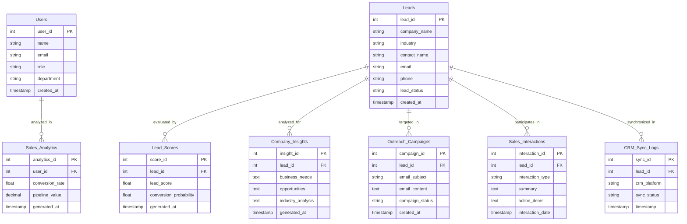

# SalesGenie AI – Database DevOps & Schema Baseline

> **Infosys Virtual Internship 7.0**  
> **Project:** SalesGenie AI – AI Sales Assistant & Lead Intelligence Platform  
> **Role:** Database DevOps Engineer  

---

## 1. Overview of Completed Responsibilities

As the Database DevOps Engineer, this repository provides the complete technical baseline:
1. **Git Branching Workflow**: Safe, isolated branching model protecting `main`.
2. **Docker Baseline**: One-command PostgreSQL 16 service with persistent data and automated schema initialization.
3. **PostgreSQL Relational Schema**: Finalized 8-table architecture centered on lead intelligence.
4. **Assigned Tables Prepared**: Detailed implementation of `Outreach_Campaigns` and `Lead_Scores` with foreign keys and performance indexes.
5. **SQLAlchemy & Alembic**: ORM models and version-controlled migration pipeline.

---

## 2. Safe Git Branching Strategy

To ensure team collaboration remains smooth and no untested changes break the main branch, use this standard Git workflow:

```
[main]                     <-- Stable, production-ready code (Protected)
  │
  └── [develop]            <-- Integration branch where team features merge
        │
        └── [feature/db-devops-baseline]  <-- Your working branch
```

### Git Commands Step-by-Step

1. **Check current branch:**
   ```bash
   git branch
   ```

2. **Create and switch to your feature branch:**
   ```bash
   git checkout -b feature/db-devops-baseline
   ```

3. **Stage your files locally:**
   ```bash
   git add .
   ```

4. **Commit with a descriptive message:**
   ```bash
   git commit -m "feat(db): establish Docker baseline, 8-table schema, and SQLAlchemy models"
   ```

5. **Push ONLY your feature branch (when you are ready):**
   ```bash
   git push -u origin feature/db-devops-baseline
   ```
   *(Your teammates can then review your Pull Request without any risk to `main`)*.

---

## 3. Docker PostgreSQL Development Environment

We use Docker to run PostgreSQL 16 Alpine so there is no need to manually configure database servers on Windows.

### Prerequisites
* Install [Docker Desktop for Windows](https://www.docker.com/products/docker-desktop/) (enable WSL 2 backend).

### Starting the Database

1. **Configure Environment Secrets:**
   Copy `.env.example` to `.env`:
   ```bash
   cp .env.example .env
   ```
   *(On Windows PowerShell: `Copy-Item .env.example .env`)*

2. **Start PostgreSQL in Background:**
   ```bash
   docker compose up -d
   ```
   *PostgreSQL will start on port `5432` and automatically execute `init_schema.sql` on first startup.*

3. **Check Container Status & Logs:**
   ```bash
   docker compose ps
   docker compose logs db
   ```

4. **Stop PostgreSQL:**
   ```bash
   docker compose down
   ```
   *(Your database data remains safe inside the Docker volume `postgres_data`)*.

---

## 4. Entity-Relationship (ER) Diagram



---

## 5. Assigned Tables: Design & Indexing Details

### A. `Outreach_Campaigns`
* **Purpose:** Stores AI-generated email subjects, customized message bodies, and sending states.
* **Foreign Key:** `lead_id REFERENCES leads(lead_id) ON DELETE CASCADE`.
* **Indexes:**
  * `ix_outreach_campaigns_lead_id`: Accelerates queries fetching all campaigns for a specific lead.
  * `ix_outreach_campaigns_status`: Speeds up filtering campaigns by state (`Draft`, `Scheduled`, `Sent`, `Opened`).
  * Composite index `ix_outreach_lead_status (lead_id, campaign_status)`: Optimizes simultaneous filtering by prospect and state.

### B. `Lead_Scores`
* **Purpose:** Captures the AI qualification score (0–100) and conversion probability (0.00–1.00).
* **Foreign Key:** `lead_id REFERENCES leads(lead_id) ON DELETE CASCADE`.
* **Indexes:**
  * `ix_lead_scores_lead_id`: Rapid lookup of qualification history for any prospect.
  * `ix_lead_scores_lead_score`: Enables fast sorting on the sales dashboard to highlight highest-scoring leads.
  * Composite index `ix_lead_scores_score_prob (lead_score, conversion_probability)`: Speeds up lead prioritization algorithms.

---

## 6. SQLAlchemy Models & Alembic Migrations

### Setting Up Python Environment

1. **Create and activate a virtual environment:**
   ```bash
   python -m venv .venv
   # Windows PowerShell:
   .\.venv\Scripts\Activate.ps1
   ```

2. **Install project dependencies:**
   ```bash
   pip install -r requirements.txt
   ```

### Running Database Migrations

* **Apply all migrations to PostgreSQL:**
  ```bash
  alembic upgrade head
  ```

* **Roll back the last migration:**
  ```bash
  alembic downgrade -1
  ```

* **Generate a new migration if models change:**
  ```bash
  alembic revision --autogenerate -m "describe schema changes"
  ```

---

## 7. How to Copy Files into `d:\Infosys\Team-C` (When Ready)

Whenever you are ready to bring these files into your team repository, you can simply copy them:

```powershell
Copy-Item -Path "C:\Users\M Sai Surekha\.gemini\antigravity\scratch\salesgenie-db-workspace\*" -Destination "D:\Infosys\Team-C" -Recurse -Force
```
*(Remember: copying files locally still touches zero remote GitHub branches until you commit and push!)*
